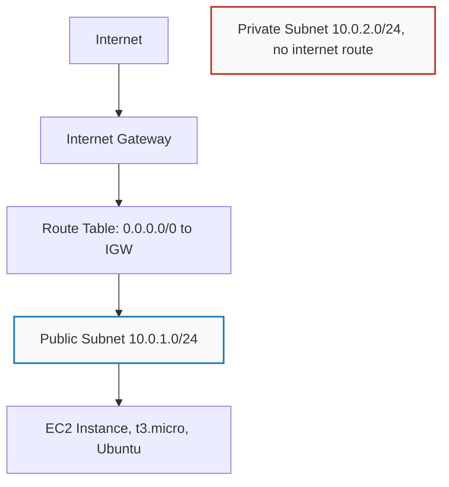

# AWS Secure Infrastructure Foundations

Hands-on lab work covering network segmentation, least privilege IAM design, and a
recreated S3 misconfiguration breach. Built, broken, and fixed personally in a live
AWS account.

## 1. Network Architecture: VPC Segmentation

I designed and built a VPC with separate public and private subnets, so that a
compromised web server cannot reach the database directly. The database is protected
by network design, not just by a password.



**Decisions made:**
- VPC CIDR set to `10.0.0.0/16`, with subnets sliced into `/24`s for a clear split
  between public and private
- Only the public subnet is attached to the internet routing table. The private
  subnet is left on the VPC's default route table, which has no path to the internet
- The Security Group on the EC2 instance allows SSH only from one known IP address,
  never from anywhere on the internet
- Login to the server uses a key pair, not a password

## 2. IAM: Least Privilege Policy Design

Instead of leaving broad admin access attached for ongoing work, I wrote a policy
scoped to exactly what was needed.

```json
{
  "Version": "2012-10-17",
  "Statement": [
    {
      "Effect": "Allow",
      "Action": "s3:ListBucket",
      "Resource": "arn:aws:s3:::jebsonseo-practice-bucket-2026"
    },
    {
      "Effect": "Allow",
      "Action": "s3:GetObject",
      "Resource": "arn:aws:s3:::jebsonseo-practice-bucket-2026/*"
    }
  ]
}
```

This grants read only access to S3. No write, no delete, no ability to change bucket
permissions. It is a working example of least privilege, not just a definition of it.

## 3. Lab: Recreating the S3 Public Bucket Breach

One of the most common real world cloud breaches is a misconfigured S3 bucket left
open to the public. I recreated that exact failure on purpose, in a controlled way,
to understand both how it happens and how to fix it.

### What I did
1. Created a bucket with AWS's default protection turned on, Block Public Access
2. Confirmed the uploaded file returned a 403 Access Denied when I tried to open its
   public URL
3. Turned off Block Public Access and attached a bucket policy allowing access from
   anyone, the same misconfiguration behind real world breaches
4. Confirmed the file was now publicly reachable
5. Reversed both changes immediately. Re-enabled Block Public Access, deleted the
   open policy, and confirmed the file went back to returning Access Denied

### Why the breach requires two failures, not one
A bucket only becomes public if two separate protections fail at the same time.
Block Public Access has to be turned off, and the bucket policy has to explicitly
allow public access. Either protection alone would have stopped it. This is why
Block Public Access exists as an override sitting above the policy itself. It blocks
public access even if the policy is already misconfigured to allow it, unless someone
deliberately disables it.

### Checked in CloudTrail
The exact API call that changed the bucket policy, PutBucketPolicy, is recorded in
CloudTrail with the IAM identity that made the change, the time it happened, and the
source IP address. Every configuration change in this account can be traced back to a
specific person. Nothing happens anonymously.

## Tools and Services Used
AWS VPC, EC2, S3, IAM, CloudTrail, CloudWatch

## Author
Sheriffdeen, JebsonSEO. Building toward Cloud Security Engineering.

## 4. Terraform: Secure AWS Infrastructure Automation

I extended the project by provisioning and hardening AWS infrastructure with
Terraform. The goal was to make infrastructure changes reproducible, reviewable,
and easier to validate against security best practices.

### Infrastructure and security controls

- **Network segmentation:** Separate public and private subnets, with internet
  routing configured for the public subnet.
- **Security groups:** No inbound rules on the lab instance's security group;
  outbound traffic is restricted to HTTPS.
- **IAM:** An EC2 instance role with the Amazon SSM Managed Instance Core policy,
  allowing management through AWS Systems Manager Session Manager.
- **EC2 hardening:** IMDSv2 is required, the root EBS volume is encrypted, and
  detailed CloudWatch monitoring is enabled.
- **VPC Flow Logs:** VPC traffic logging is enabled and sent to CloudWatch Logs.
- **Log encryption:** A customer-managed AWS KMS key encrypts the Flow Logs
  log group, with automatic key rotation enabled.
- **Infrastructure as Code:** Terraform manages the infrastructure configuration,
  while Git tracks reviewed changes.

### Security validation with Checkov

I scanned the Terraform configuration using Checkov 3.3.28.

| Result | Checks |
|---|---:|
| Passed | 78 |
| Failed | 3 |
| Skipped with documented exceptions | 3 |

The scan identified three findings that remain unresolved:

| Check | Finding | Current decision |
|---|---|---|
| CKV_AWS_135 | EC2 EBS optimization | Deferred pending review of instance impact and replacement risk. |
| CKV_AWS_88 | EC2 instance has a public IP | Deferred until a private management path is planned and verified. |
| CKV_AWS_338 | CloudWatch log retention is below one year | Seven-day retention retained as a cost-conscious lab decision. |

Three additional findings—CKV_AWS_109, CKV_AWS_356, and CKV_AWS_111—were
suppressed with documented explanations for the KMS key policy. These are accepted
scanner exceptions, not passed checks, and the underlying policy must remain under
review.

### Security trade-offs

This is a learning environment, not a declaration of production readiness.
The instance still has a public IP, and the log retention period is shorter than
the one-year period recommended by Checkov. These choices are documented so they
can be revisited as the architecture and budget evolve.

The next improvements include evaluating private instance management, reviewing
the remaining Checkov findings, and incorporating security checks into an
automated infrastructure workflow.

### Tools and Services

Terraform, Checkov, AWS VPC, EC2, IAM, Systems Manager, VPC Flow Logs,
CloudWatch Logs, AWS KMS, Git, and GitHub.

### Security validation with Trivy

Trivy is integrated into GitHub Actions to scan Terraform for security
misconfigurations. The scanner is pinned to version 0.76.0, and the workflow
fails when HIGH or CRITICAL findings are detected.

The scan identified one unresolved CRITICAL finding:

| Finding | Severity | Current decision |
|---|---|---|
| AWS-0104 | CRITICAL | Outbound TCP 443 permits connections to any IPv4 destination (`0.0.0.0/0`). Retained temporarily while evaluating safer alternatives. |

**Risk:** The rule allows HTTPS connections to any IPv4 destination.
Restricting destinations requires identifying necessary service endpoints
and verifying that Systems Manager connectivity remains functional.

This finding remains unresolved. Successful Terraform validation does not
mean the security scan is clean.
