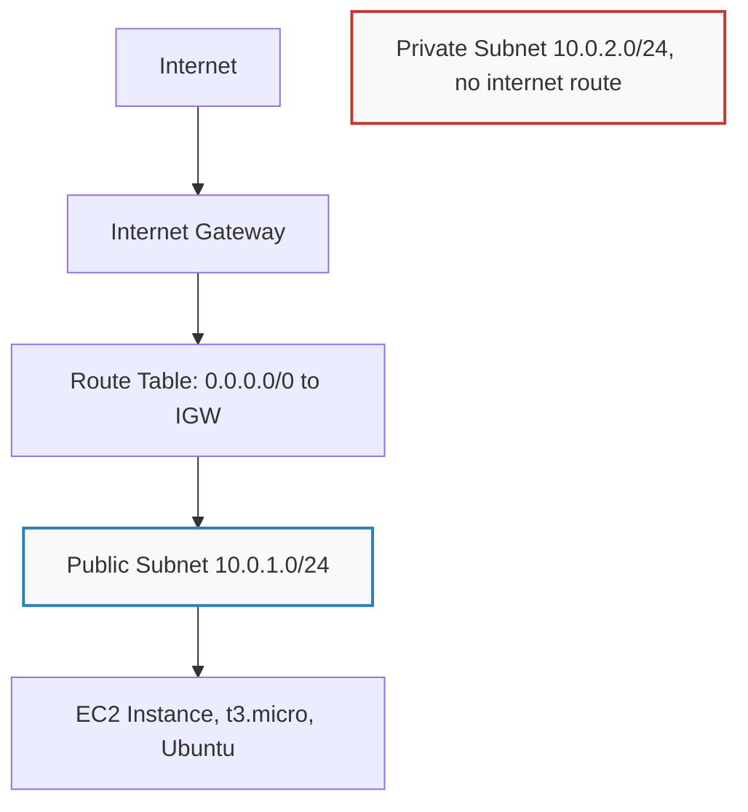

# AWS Secure Infrastructure Foundations

Hands-on lab work covering network segmentation, least privilege IAM design, and a
recreated S3 misconfiguration breach. Built, broken, and fixed personally in a live
AWS account.

## 1. Network Architecture: VPC Segmentation

I designed and built a VPC with separate public and private subnets, so that a
compromised web server cannot reach the database directly. The database is protected
by network design, not just by a password.



**Decisions made:**
- VPC CIDR set to `10.0.0.0/16`, with subnets sliced into `/24`s for a clear split
  between public and private
- Only the public subnet is attached to the internet routing table. The private
  subnet is left on the VPC's default route table, which has no path to the internet
- The Security Group on the EC2 instance allows SSH only from one known IP address,
  never from anywhere on the internet
- Login to the server uses a key pair, not a password

## 2. IAM: Least Privilege Policy Design

Instead of leaving broad admin access attached for ongoing work, I wrote a policy
scoped to exactly what was needed.

```json
{
  "Version": "2012-10-17",
  "Statement": [
    {
      "Effect": "Allow",
      "Action": "s3:ListBucket",
      "Resource": "arn:aws:s3:::jebsonseo-practice-bucket-2026"
    },
    {
      "Effect": "Allow",
      "Action": "s3:GetObject",
      "Resource": "arn:aws:s3:::jebsonseo-practice-bucket-2026/*"
    }
  ]
}
```

This grants read only access to S3. No write, no delete, no ability to change bucket
permissions. It is a working example of least privilege, not just a definition of it.

## 3. Lab: Recreating the S3 Public Bucket Breach

One of the most common real world cloud breaches is a misconfigured S3 bucket left
open to the public. I recreated that exact failure on purpose, in a controlled way,
to understand both how it happens and how to fix it.

### What I did
1. Created a bucket with AWS's default protection turned on, Block Public Access
2. Confirmed the uploaded file returned a 403 Access Denied when I tried to open its
   public URL
3. Turned off Block Public Access and attached a bucket policy allowing access from
   anyone, the same misconfiguration behind real world breaches
4. Confirmed the file was now publicly reachable
5. Reversed both changes immediately. Re-enabled Block Public Access, deleted the
   open policy, and confirmed the file went back to returning Access Denied

### Why the breach requires two failures, not one
A bucket only becomes public if two separate protections fail at the same time.
Block Public Access has to be turned off, and the bucket policy has to explicitly
allow public access. Either protection alone would have stopped it. This is why
Block Public Access exists as an override sitting above the policy itself. It blocks
public access even if the policy is already misconfigured to allow it, unless someone
deliberately disables it.

### Checked in CloudTrail
The exact API call that changed the bucket policy, PutBucketPolicy, is recorded in
CloudTrail with the IAM identity that made the change, the time it happened, and the
source IP address. Every configuration change in this account can be traced back to a
specific person. Nothing happens anonymously.

## Tools and Services Used
AWS VPC, EC2, S3, IAM, CloudTrail, CloudWatch

## Author
Sheriffdeen, JebsonSEO. Building toward Cloud Security Engineering.

## 4. Terraform: Secure AWS Infrastructure Automation

I extended the project by provisioning and hardening AWS infrastructure with
Terraform. The goal was to make infrastructure changes reproducible, reviewable,
and easier to validate against security best practices.

### Infrastructure and security controls

- **Network segmentation:** Separate public and private subnets, with internet
  routing configured for the public subnet.
- **Security groups:** No inbound rules on the lab instance's security group;
  outbound traffic is restricted to HTTPS.
- **IAM:** An EC2 instance role with the Amazon SSM Managed Instance Core policy,
  allowing management through AWS Systems Manager Session Manager.
- **EC2 hardening:** IMDSv2 is required, the root EBS volume is encrypted, and
  detailed CloudWatch monitoring is enabled.
- **VPC Flow Logs:** VPC traffic logging is enabled and sent to CloudWatch Logs.
- **Log encryption:** A customer-managed AWS KMS key encrypts the Flow Logs
  log group, with automatic key rotation enabled.
- **Infrastructure as Code:** Terraform manages the infrastructure configuration,
  while Git tracks reviewed changes.

### Security validation with Checkov

I scanned the Terraform configuration using Checkov 3.3.28.

| Result | Checks |
|---|---:|
| Passed | 78 |
| Failed | 3 |
| Skipped with documented exceptions | 3 |

The scan identified three findings that remain unresolved:

| Check | Finding | Current decision |
|---|---|---|
| CKV_AWS_135 | EC2 EBS optimization | Deferred pending review of instance impact and replacement risk. |
| CKV_AWS_88 | EC2 instance has a public IP | Deferred until a private management path is planned and verified. |
| CKV_AWS_338 | CloudWatch log retention is below one year | Seven-day retention retained as a cost-conscious lab decision. |

Three additional findings—CKV_AWS_109, CKV_AWS_356, and CKV_AWS_111—were
suppressed with documented explanations for the KMS key policy. These are accepted
scanner exceptions, not passed checks, and the underlying policy must remain under
review.

### Security trade-offs

This is a learning environment, not a declaration of production readiness.
The instance still has a public IP, and the log retention period is shorter than
the one-year period recommended by Checkov. These choices are documented so they
can be revisited as the architecture and budget evolve.

The next improvements include evaluating private instance management, reviewing
the remaining Checkov findings, and incorporating security checks into an
automated infrastructure workflow.

### Tools and Services

Terraform, Checkov, AWS VPC, EC2, IAM, Systems Manager, VPC Flow Logs,
CloudWatch Logs, AWS KMS, Git, and GitHub.

### Security validation with Trivy

Trivy is integrated into GitHub Actions to scan Terraform for security
misconfigurations. The scanner is pinned to version 0.76.0, and the workflow
fails when HIGH or CRITICAL findings are detected.

#### Finding: AWS-0104 — Unrestricted Egress

**Severity:** CRITICAL
**Status:** Remediated; required CI checks passed.

Trivy identified a security group rule that permitted outbound TCP port 443
connections to any IPv4 destination (`0.0.0.0/0`).

Although the rule restricted the protocol and port, it did not restrict
the destination. This created broader outbound network access than the
CloudGuard instance required.

#### Remediation

The unrestricted egress rule was removed and replaced with a standalone
Terraform security-group egress rule.

The updated configuration permits outbound TCP port 443 only to the
CloudGuard Systems Manager VPC endpoint security group.

Two interface VPC endpoints were configured:

- `ssm`
- `ssmmessages`

Private DNS is enabled for both endpoints. The endpoint security group
allows inbound TCP port 443 from the CloudGuard EC2 security group.

#### Verification

The remediation was verified through the following checks:

- `terraform validate` completed successfully.
- `terraform plan` reported no changes after the infrastructure was reconciled.
- AWS CLI inspection confirmed that EC2 egress targets the endpoint security
  group rather than `0.0.0.0/0`.
- AWS CLI inspection confirmed that the endpoint security group permits
  inbound TCP port 443 from the EC2 security group.
- GitHub Actions passed all three checks on pull request #1, including
  Checkov Security Scan and Mandatory Terraform CI.
- The remediation was merged into `main`.

These results confirm that the infrastructure configuration was updated
and the configured CI checks passed. Successful CI checks alone do not
prove that Systems Manager connectivity works end to end; that remains
a separate verification task.

#### Engineering lesson

A restricted port does not necessarily mean restricted network access.
Security-group rules should limit both the permitted traffic and its
intended destinations. Automated security findings should be investigated
and remediated rather than suppressed simply to obtain a passing build.

## Jenkins: SCM-Integrated Terraform Security Pipeline

I integrated Jenkins with the CloudGuard GitHub repository to run automated infrastructure validation and security scanning against version-controlled Terraform code.

### Pipeline stages

The `Jenkinsfile` defines these stages:

1. **Source Checkout** : retrieves the project from GitHub and records the build and commit details.
2. **Environment Check** : verifies that Git, Terraform, and Checkov are available.
3. **Terraform Format Check** : checks Terraform formatting.
4. **Terraform Initialization** : initializes the Terraform working directory using the committed dependency lock file.
5. **Terraform Validation** : validates the Terraform configuration.
6. **Checkov Security Scan** : scans the Terraform configuration for security misconfigurations.

The pipeline uses timestamps, prevents concurrent builds of the same job, and reports success or failure through its post-build actions.

### Troubleshooting Terraform initialization

The initial Jenkins build failed during Terraform initialization because the machine could not establish an HTTPS connection to `registry.terraform.io`.

Testing confirmed that general HTTPS connectivity worked, while connections to the Terraform Registry timed out.

The AWS provider version `6.68.0` was already present in the Jenkins workspace. I configured a Terraform plugin cache for the Jenkins service account and successfully initialized the workspace using the previously installed provider.

This resolved the initialization failure in the tested workspace. The solution should continue to be verified on fresh workspaces to ensure that provider availability is reproducible.

### Security scan results

The targeted Checkov tests produced the following results when the corresponding configuration settings were enabled:

| Check | Requirement | Targeted test |
|---|---|---|
| CKV_AWS_135 | EC2 EBS optimization | Passed |
| CKV_AWS_88 | EC2 instance should not have a public IP | Passed |
| CKV_AWS_338 | CloudWatch log retention of at least one year | Passed |

The current EC2 configuration still has two outstanding findings:

- **CKV_AWS_135:** EBS optimization is disabled.
- **CKV_AWS_88:** The instance is configured with a public IP address.

Changing these settings caused Terraform to plan replacement of the existing EC2 instance. I reverted the temporary changes and did not apply that replacement.

These findings remain open for a future infrastructure redesign. They have not been suppressed merely to produce a passing scan.

### CloudWatch retention improvement

The VPC Flow Logs retention period was increased from 7 days to 365 days.

The change was applied successfully through Terraform and verified directly using the AWS CLI. Terraform reported one resource changed and no resources added or destroyed.

The configuration change was merged into main  through pull request #12, with both required GitHub Actions checks passing.

### Engineering lessons

- A successful Terraform validation does not guarantee that security policies pass.
- A successful Checkov scan does not prove that changes can be applied without infrastructure impact.
- Provider caching can help when registry connectivity is unreliable, but fresh-workspace initialization must also be tested.
- Security findings should be investigated and documented rather than hidden to obtain a green build.
- CI/CD should validate infrastructure changes without automatically applying potentially destructive modifications.

### Ansible Security Baseline Auditing

CloudGuard uses Ansible to perform repeatable security baseline checks on a Linux host. The baseline role evaluates selected system services and checks explicitly configured SSH security directives against defined expectations.

**Implemented capabilities**

- **Service auditing:** Checks the operational states of selected system services, including SSH, cron and systemd-resolved.
- **SSH configuration auditing:** Evaluates `PermitRootLogin`, `PasswordAuthentication`, `PermitEmptyPasswords` and `X11Forwarding` against a defined security baseline.
- **Finding classification:** Classifies SSH settings as `OK`, `REVIEW` or `INVESTIGATION_REQUIRED`, depending on the observed configuration.
- **Audit reporting:** Reports individual findings and summarises the number of settings that pass the baseline checks and those requiring further attention.
- **Validation and testing:** Validates the Ansible role and tests the SSH classification logic against different configuration values.
- **CI/CD integration:** Integrates the Ansible baseline audit into the existing Jenkins pipeline.

**Current limitation**

The SSH audit examines explicitly configured directives in `/etc/ssh/sshd_config`. It does not fully evaluate effective SSH settings, including configuration inheritance, included files and default values. Findings therefore require appropriate interpretation and further investigation where necessary.

The role is designed for security auditing. Its current SSH audit reports findings without changing SSH security settings.
